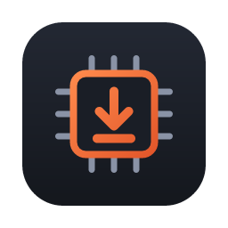
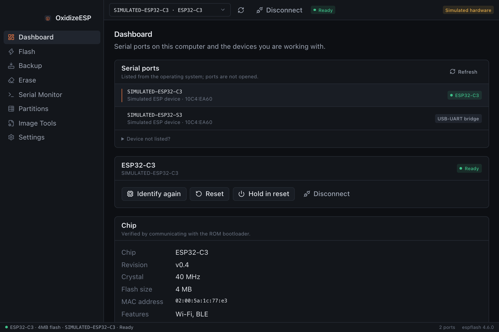
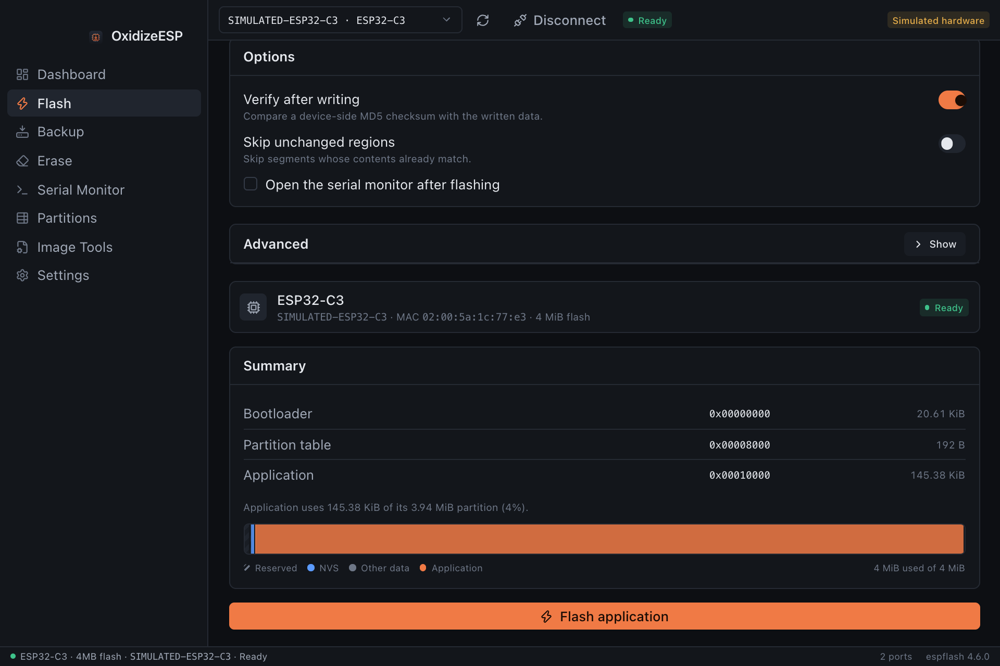
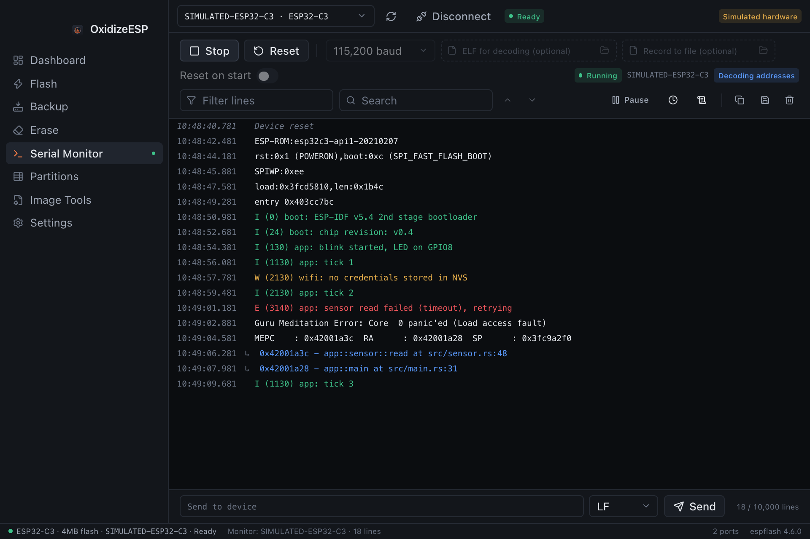

<p align="center">
  
</p>

<h1 align="center">OxidizeESP</h1>

<p align="center">
  A cross-platform desktop application for flashing, monitoring, backing up and managing Espressif microcontrollers.
</p>

OxidizeESP puts the functionality of [espflash](https://github.com/esp-rs/espflash) into a native desktop
interface. It talks to devices through the espflash Rust library directly, so it needs no Python, no
separately installed espflash executable and no network connection.

OxidizeESP is an independent project and is not affiliated with or endorsed by Espressif Systems.



## Features

**Devices**
- Lists serial ports with USB VID/PID, manufacturer, product and serial number, without opening them
- Identifies the chip on request: model, revision, crystal, flash size, MAC address, features and security state
- Keeps operating-system port metadata separate from information verified by the bootloader
- Follows a device to a new port name when its USB serial number matches
- Reset and hold-in-reset (enter the ROM bootloader), and support for several devices at once

**Flashing**
- Flashes application ELF files as ESP-IDF images (bootloader, partition table and application)
- Shows the exact flash layout before writing, including the partition table
- Writes raw binaries to an explicitly entered offset, with validation of alignment, size and image chip ID
- Flash mode, size and frequency, custom bootloader and partition table, minimum chip revision, MMU page size
- Verification with device-side checksums, skipping of unchanged regions and real progress reporting

Before anything is written, the flash view shows the exact layout the image will produce and how much of the
application partition it uses.



**Backup and checksums**
- Reads the complete flash or a region to a file, streamed in bounded chunks with progress and cancellation
- Backups are written to a temporary file and only saved after a complete read
- A metadata file records chip, MAC address, port, region, timestamp, application version and SHA-256
- Device-side MD5 checksums of flash regions, with comparison against local files
- Backups can be verified later and reused as input for flashing

**Erase**
- Erase a sector-aligned region, named partitions (from the device or a partition table file) or the entire flash
- Explicit confirmation for every erase; erasing the entire flash requires typing a confirmation

**Serial monitor**
- Real-time output with timestamps, ANSI colors, filtering, search, pause, autoscroll and a bounded buffer
- Virtualized rendering that stays responsive with large buffers
- Resolves code addresses (for example in panic backtraces) to functions and source lines using the firmware ELF
- Sends text with a selectable line ending, resets the device, saves the buffer or records to a file
- Reconnects automatically when the same device is plugged in again

Panic backtraces are resolved to functions and source lines when the firmware ELF is selected.



**Partition tables**
- Opens CSV and binary partition tables or reads the table from the device
- Validates overlaps, alignment and fit, and shows a memory map
- Exports to CSV or binary

**Image tools**
- Converts an ELF into a flashable application image or a merged image without a connected device

## Platform support

| Platform | Architecture | Package |
| --- | --- | --- |
| macOS 11 or later | Apple Silicon (arm64) | DMG |
| macOS 11 or later | Intel (x86_64) | DMG |
| Windows 10 or later | x64 | NSIS installer (per-user) |

The code base contains no platform-specific assumptions that would prevent a Linux build, but Linux packages
are not published yet.

## Supported devices

OxidizeESP supports the chips supported by espflash 4.6: ESP32, ESP32-C2, ESP32-C3, ESP32-C5, ESP32-C6,
ESP32-C61, ESP32-H2, ESP32-H4, ESP32-P4, ESP32-S2, ESP32-S3 and ESP32-S31. Devices can be connected through a
USB-to-UART bridge (CP210x, CH34x, FTDI and others) or through the chip's built-in USB-Serial-JTAG interface.

The ESP8266 is not supported.

### Known limitations

- A flash write cannot be interrupted safely once it has started. Backups and region erases can be cancelled
  between chunks.
- Erasing the entire flash reports no progress because the bootloader performs it as a single command.
- defmt log decoding and RISC-V stack-dump unwinding, which the espflash command-line monitor offers, are not
  available. Address resolution in the monitor works for all chips.
- Loading an application into RAM (`espflash flash --ram`) and eFuse operations are not included.
- With Secure Download Mode enabled, flash reads, verification and flash size detection are not available.
- Backups of devices with flash encryption or Secure Boot contain device-specific data and cannot be restored to
  other devices. A backup never includes eFuses.

## Installation

Development builds of the latest commit on `main` are published as the
[rolling release](../../releases/tag/rolling). Download the file for your platform and verify it against
`SHA256SUMS.txt` if desired.

- **macOS:** the app is signed with a Developer ID certificate and notarized by Apple. Open the DMG, drag
  OxidizeESP to Applications and open it as usual.
- **Windows:** the installer is not code signed yet, so SmartScreen may warn about an unrecognized app. Choose
  **More info → Run anyway** to install. The installer installs for the current user and needs no administrator
  rights.

Depending on your board, you may need a driver for its USB-to-UART bridge (Silicon Labs CP210x, WCH CH34x or
FTDI). Boards that use the chip's native USB interface need no driver on current macOS and Windows versions.

## Building from source

Requirements:

- Rust (stable, 1.95 or newer)
- Node.js 22 or newer with npm
- Platform prerequisites for Tauri 2: Xcode Command Line Tools on macOS, Microsoft C++ Build Tools and WebView2 on
  Windows (see the [Tauri prerequisites](https://v2.tauri.app/start/prerequisites/))

```sh
cd apps/desktop
npm ci
npm run tauri dev                      # run against real hardware
npm run tauri dev -- --features mock-hardware   # run with simulated devices
npm run tauri build                    # build an installer for the current platform
```

See [docs/development.md](docs/development.md) for the development workflow and tests, and
[docs/building.md](docs/building.md) for release builds, cross-compilation and code signing.

## Architecture

```text
apps/desktop/                 Svelte 5 + TypeScript frontend
apps/desktop/src-tauri/       Tauri 2 application: commands, IPC channels, configuration
crates/oxidizeesp-core/       Hardware core and application services (no UI dependencies)
```

The Rust core owns all hardware access, validation, device sessions and long-running operations. The Tauri
layer only translates IPC requests into calls on the core and forwards progress events. TypeScript types for
all requests, responses and events are generated from the Rust definitions. See
[docs/architecture.md](docs/architecture.md) for details.

## Troubleshooting

| Problem | What to try |
| --- | --- |
| No serial port appears | Use a data-capable USB cable; install the driver for the board's USB-to-UART bridge. |
| "Port in use" | Close other serial monitors, IDEs or terminals using the port. Stop OxidizeESP's own monitor before flashing. |
| Connection fails or times out | Hold **BOOT** while pressing **RESET** to enter download mode manually, then use *Reset before: None*. Try a lower baud rate. |
| Native USB device disappears during flashing | Chips using USB-Serial-JTAG re-enumerate on reset; select *USB-Serial-JTAG* as the reset method. |
| Verification fails | Lower the baud rate and check the cable; the flash may contain partially written data until the write succeeds. |
| Permission denied (Linux) | Add your user to the group that owns the serial device, usually `dialout` or `uucp`. |
| "No application descriptor" | Add `esp_app_desc!()` (esp-bootloader-esp-idf) to esp-hal firmware, or disable the check in the advanced options. |

Application logs can be opened from **Settings → Logging**.

## Related projects

- [espflash](https://github.com/esp-rs/espflash): the flashing library and command-line tool OxidizeESP is built on
- [esp-idf-part](https://github.com/esp-rs/esp-idf-part): ESP-IDF partition table parsing
- [Tauri](https://tauri.app): the desktop application framework
- [esptool](https://github.com/espressif/esptool): Espressif's official flashing tool

## Contributing

Issues and pull requests are welcome. Please run the checks described in
[docs/development.md](docs/development.md) before submitting changes, and include the chip, board and
operating system when reporting hardware problems.

## License

Licensed under either of [Apache License, Version 2.0](LICENSE-APACHE) or [MIT license](LICENSE-MIT) at your
option, matching espflash.
